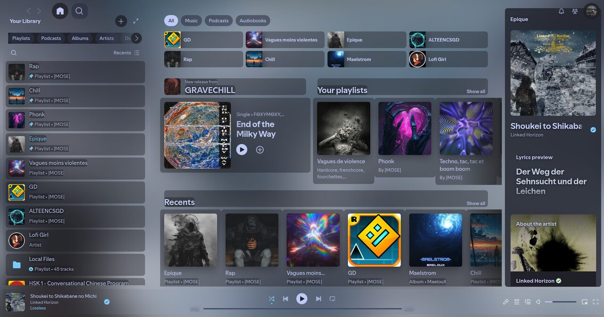
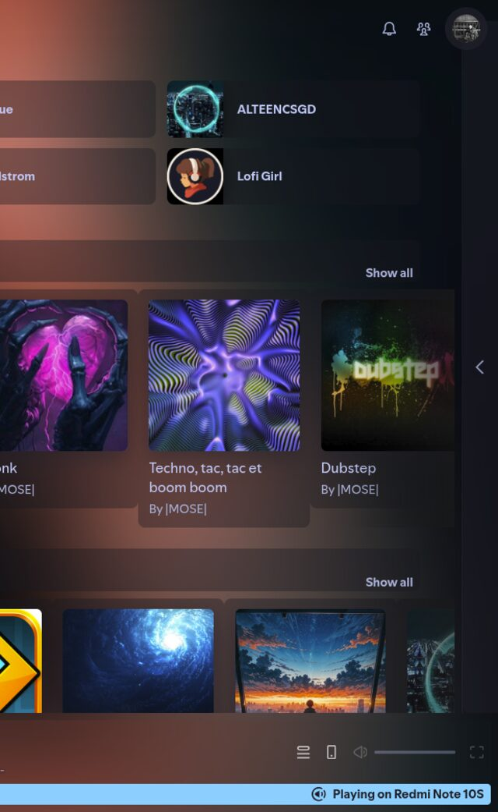

# Glass — full-cover glassmorphism for Spotify

Full-window blurred album-art wallpaper, unified translucent panels that blend into it,
and a spectrum in the playback bar that actually reacts to the song.




Built on [Sleek](https://github.com/spicetify/spicetify-themes/tree/master/Sleek) + TokyoNight,
for **spicetify 2.46.4 / Spotify 1.3.4** (Linux). Other setups untested — the CSS targets
Spotify's current (`main-*`) class names, which change on major layout updates.

## What's inside

| Piece | What it does |
|---|---|
| `ext-src/cover-bg.js` | Blurred full-window wallpaper from the current cover art; samples 3 dominant colors into `--song-c1..3` CSS tokens used by the whole UI |
| `ext-src/spectrum.js` | Frequency bars behind the playback controls. Spotify renders no in-page `<audio>` element, so instead of WebAudio this uses Spotify's own audio-analysis data (per-segment loudness + pitch envelope) driven by `Spicetify.Player.getProgress()` — sample-synced, not a loop animation |
| `ext-src/hover-glow.js` | Soft glow behind the hovered library shortcut |
| `custom-tweaks.css` | The unified layer: one shared whisper-alpha surface (`.38`) for cards, rows and panels, transparent nav/sidebars, animated song-color progress gradient, thin rounded scrollbars, hover underline on sidebar rows |

## Install

1. Install the base theme first:

   ```bash
   spicetify config current_theme Sleek color_scheme TokyoNight
   ```

   (with `Sleek/` and `TokyoNight/` present in `~/.config/spicetify/Themes/` from
   [spicetify-themes](https://github.com/spicetify/spicetify-themes)).

2. Run the deploy script:

   ```bash
   ./deploy.sh
   ```

   It copies the extensions, appends `custom-tweaks.css` to Sleek's `user.css`
   (idempotent — the block is replaced on every run via its marker), enables the
   extensions and runs `spicetify apply`. Adjust `SPOTIFY_DIR` at the top for your
   platform (`/opt/spotify` on Arch; `%APPDATA%/Spotify` on Windows).

   Manual equivalent:

   ```bash
   cp ext-src/*.js ~/.config/spicetify/Extensions/
   cp ext-src/*.js /opt/spotify/Apps/xpui/extensions/     # 2.46.4 injects from here
   cat custom-tweaks.css >> ~/.config/spicetify/Themes/Sleek/user.css
   spicetify config extensions "cover-bg.js | hover-glow.js | spectrum.js"
   spicetify apply
   ```

3. Restart Spotify.

## Uninstall

```bash
spicetify restore
rm ~/.config/spicetify/Extensions/{cover-bg,hover-glow,spectrum}.js
```

## Tweaking

- Surface strength: every panel uses `rgba(16, 17, 24, .38)` in `custom-tweaks.css` —
  raise it if the wallpaper feels too loud, lower it for more bleed-through.
- Accent colors are automatic: they come from the cover art (`--song-c1/2/3`).
- Spectrum size/feel: `BARS` and height scaling at the top of `spectrum.js`.

## Gotchas seen in the wild

- If `spicetify apply` prints *"Preprocessed Spotify data is outdated"*, run
  `spicetify restore backup apply` once.
- On 2.46.4 the extension list must be one pipe-separated string
  (`"a.js | b.js | c.js"`).

## Credits

Idea inspiration: [Frostify](https://github.com/gwennlbh/Frostify). Base theme: Sleek
(spacextrav, spicetify-themes).

MIT licensed — do what you want with it.
